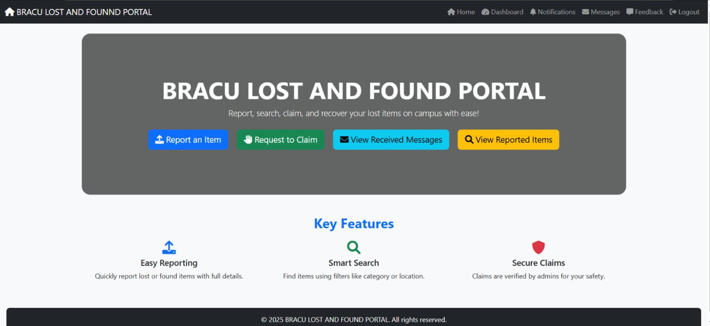
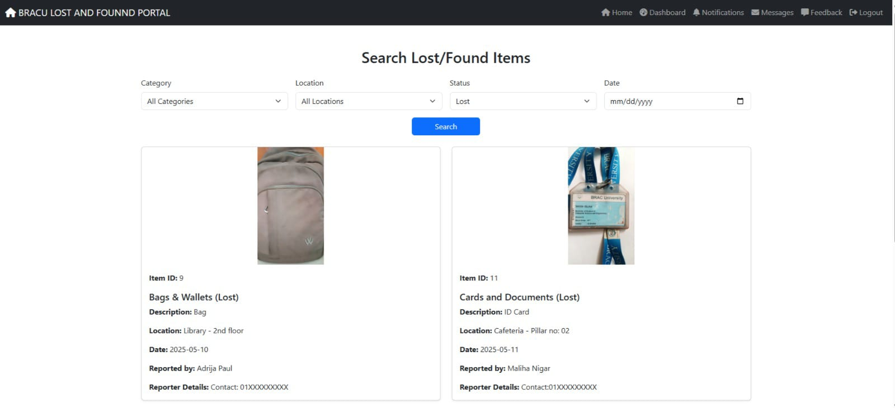
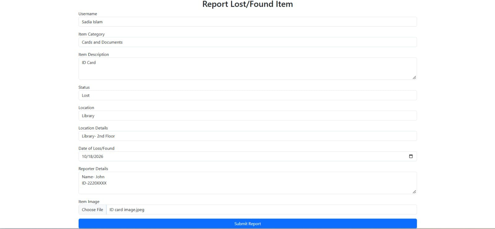
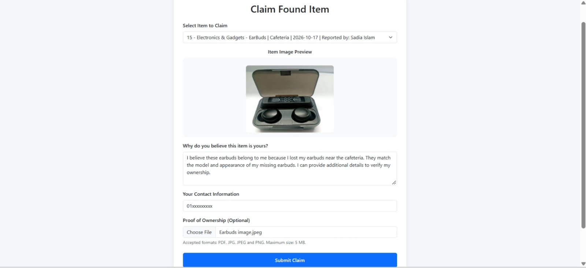
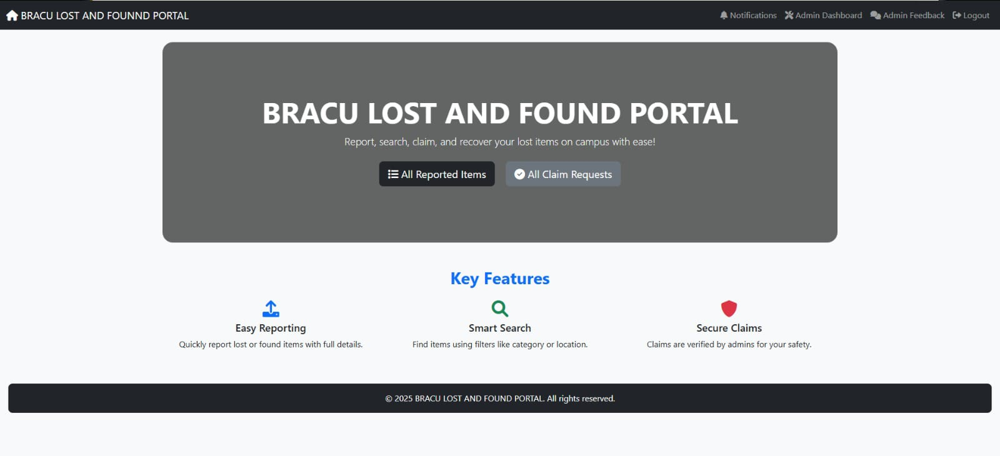

# BRACU Lost and Found Portal

A web-based lost-and-found management system developed as an independent group project by students of BRAC University.

## Project Overview

The **BRACU Lost and Found Portal** is a web application designed to make reporting lost and found belongings, browsing reported items, submitting ownership claims, and managing item recovery more organized and convenient.

The platform provides a centralized interface for users to report missing belongings, share information about found items, submit claims with supporting evidence, and communicate through the application. Administrative functionality supports the review of item reports, claim-related activities, and platform management.

This project was independently developed as a personal group project to apply web development concepts to a practical, real-world problem. Although its intended use case is related to the BRAC University community, it is not an official university platform and is not affiliated with, endorsed by, or maintained by BRAC University.

## Screenshots

The following screenshots showcase the user interface and key features of the BRACU Lost and Found Portal.

### 1. Home Page



### 2. Lost and Found Listings



### 3. Report an Item



### 4. Claim Found Item



### 5. Admin Dashboard



## Key Features

### 1. User Authentication and Account Management

- User registration and login.
- Password hashing for credential storage.
- Role-based access for supported user categories.
- Session-based access to authenticated features.
- Access control for relevant application functionality.

### 2. Lost and Found Item Management

- Submit reports for lost and found belongings.
- Provide item descriptions, categories, and location details.
- Include item images and other relevant information where supported.
- Browse reported lost and found items.
- View item details and reporting information.
- Support administrative review and approval of reports.

### 3. Item Claiming System

- Submit ownership claims for found items.
- Provide claim messages and relevant contact information.
- Upload supporting evidence where supported.
- Store claim information for review.
- Track claim status through the application.

### 4. Messaging and Communication

- Send and receive messages through the platform.
- Support communication between users.
- Facilitate the exchange of relevant information during item recovery.

### 5. Notification System

- Display notifications related to platform activities.
- Maintain notification information for users.
- Help users stay informed about relevant updates and actions.

### 6. Administrative Management

- Provide administrative access to management features.
- Review reported items and associated information.
- Manage item approval and reporting status.
- Support the handling of ownership claims.
- Assist with the overall management of platform activities.

### 7. Feedback System

- Allow users to submit feedback.
- Collect suggestions regarding the application.
- Support future improvements to usability and functionality.

*Feature availability and behavior depend on the application's implementation and configuration.*

## Technology Stack

| Technology | Purpose |
|---|---|
| PHP | Server-side application logic |
| MySQL / MariaDB | Relational database management |
| HTML5 | Web page structure |
| CSS3 | Styling and layout |
| JavaScript | Client-side interactivity |
| Bootstrap 5 | Responsive interface components |
| Apache | Web server |
| XAMPP | Local development environment |
| phpMyAdmin | Database administration |
| Git | Version control |
| GitHub | Source code hosting and collaboration |

## Project Structure

The main application is located in the `bracu_lost_and_found` directory.

```text
BRACU-LOST-AND-FOUND-PORTAL/
├── bracu_lost_and_found/
│   ├── db.php
│   ├── login.php
│   ├── register.php
│   ├── dashboard.php
│   ├── claim_item.php
│   ├── navbar.php
│   ├── uploads/
│   └── ...
├── screenshots/
│   ├── home.jpeg
│   ├── item-listings.jpeg
│   ├── report-item.jpeg
│   ├── claim-found-item.jpeg
│   └── admin-dashboard.jpeg
├── SQL/
│   └── Database SQL resources
└── README.md
```

This structure is a simplified representation of the project. Refer to the repository for the complete source code, actual filenames, and available database resources.

## Getting Started

The following instructions describe a typical local setup on Windows using XAMPP.

### Prerequisites

Install the following tools before setting up the application:

- [XAMPP](https://www.apachefriends.org/) — provides Apache, PHP, and MySQL/MariaDB services.
- [Git](https://git-scm.com/) — for cloning the repository.
- [Visual Studio Code](https://code.visualstudio.com/) or another code editor.
- A modern web browser.

### Step 1: Clone the Repository

Open PowerShell or Command Prompt and run:

```bash
git clone https://github.com/sadiaislam2023/BRACU-LOST-AND-FOUND-PORTAL.git
```

Navigate to the cloned repository:

```bash
cd BRACU-LOST-AND-FOUND-PORTAL
```

### Step 2: Configure the Project Directory

Move or copy the project into the XAMPP `htdocs` directory.

For a typical Windows installation, the repository should be located at:

```text
C:\xampp\htdocs\BRACU-LOST-AND-FOUND-PORTAL
```

The main application directory should then be:

```text
C:\xampp\htdocs\BRACU-LOST-AND-FOUND-PORTAL\bracu_lost_and_found
```

If XAMPP is installed elsewhere, use the corresponding `htdocs` directory.

### Step 3: Start Apache and MySQL

1. Open the XAMPP Control Panel.
2. Start **Apache**.
3. Start **MySQL**.
4. Confirm that both services are running.

### Step 4: Create and Import the Database

1. Open [phpMyAdmin](http://localhost/phpmyadmin/) in your browser.
2. Create a database named `bracu_lost_and_found`.
3. Select the newly created database.
4. Open the **Import** tab.
5. Select the appropriate SQL file provided in the repository.
6. Click **Import** or **Go**, depending on the interface.
7. Verify that the required database tables have been created.

The SQL file's name and location may vary. Use the actual database resource provided in the repository.

### Step 5: Configure the Database Connection

Open the `db.php` file in the `bracu_lost_and_found` directory.

For a default local XAMPP installation, the database connection settings may resemble the following:

```php
$host = "localhost";
$user = "root";
$password = "";
$database = "bracu_lost_and_found";
```

These are example settings, not a replacement for the complete database connection code. Preserve the existing connection logic and adjust the credentials according to your local MySQL configuration.

### Step 6: Launch the Application

Open your browser and visit:

```text
http://localhost/BRACU-LOST-AND-FOUND-PORTAL/bracu_lost_and_found/
```

If the application uses a specific entry-point file or a different directory structure, adjust the URL accordingly.

### Step 7: Test the Application

After launching the application, test the available features:

1. Register an account.
2. Log in using the registered credentials.
3. Submit a lost or found item report.
4. Browse the reported item listings.
5. Open an item and submit an ownership claim.
6. Test supporting evidence uploads, where available.
7. Review claim status and notifications.
8. Test the messaging and feedback functionality.
9. Verify administrative features using an authorized administrator account.

Access to particular features may depend on the assigned user role and application configuration.

## Database Overview

The application uses a relational database configured through MySQL or MariaDB.

The database resources should be inspected to identify the actual tables and relationships used by the application. The following table describes the expected responsibilities of the principal data categories; the names shown are illustrative and should be checked against the supplied SQL schema.

| Data Category | Purpose |
|---|---|
| User Accounts | Stores account information and supported roles |
| Reported Items | Stores lost and found item reports |
| Item Claims | Stores ownership claims and associated information |
| Messages | Stores communication between users |
| Notifications | Stores notification information |
| Feedback | Stores user-submitted feedback |

Use the SQL resources included in the repository to initialize the database and phpMyAdmin to inspect its tables and relationships.

## Security Considerations

The application handles user accounts, contact information, ownership claims, and potentially uploaded documents. Appropriate security practices are therefore important.

Recommended practices include:

- Hash passwords using secure password-hashing functions.
- Use prepared statements for database operations involving user input.
- Validate incoming data and escape output appropriately.
- Enforce authentication and role-based authorization on the server.
- Validate uploaded files and restrict permitted file types and sizes.
- Prevent unauthorized access to sensitive uploads and personal information.
- Keep database credentials and other secrets out of public repositories.
- Avoid exposing sensitive information in error messages.
- Use HTTPS when deploying the application publicly.

These recommendations describe good security practices; the actual security provided depends on the implementation in the source code and the deployment configuration.

## Future Improvements

Potential enhancements for future development include:

- Advanced search and filtering for lost and found items.
- More detailed claim tracking and status updates.
- Improved notification workflows.
- Enhanced mobile responsiveness and accessibility.
- Stronger upload validation and document protection.
- Expanded administrative reporting and analytics.
- Additional usability improvements.
- Deployment to a suitable PHP and MySQL hosting environment.

These items represent possible future enhancements and are not necessarily implemented in the current version.

## Contributors

This project was developed collaboratively by the following group members:

- [**Sadia Islam**](https://github.com/sadiaislam2023)
- [**Maliha Nigar**](https://github.com/MALIHANIGAR)
- [**Adrija Paul**](https://github.com/adri-ja02)

## Repository

**GitHub Repository:** [BRACU Lost and Found Portal](https://github.com/sadiaislam2023/BRACU-LOST-AND-FOUND-PORTAL)

Explore the repository for the application's source code, database resources, screenshots, and project documentation.

## Disclaimer

The BRACU Lost and Found Portal is an independent personal group project developed for educational and demonstration purposes.

It is **not an official BRAC University project, service, or platform**. It is not affiliated with, endorsed by, sponsored by, or maintained by BRAC University.

The BRACU name is used solely to describe the project's intended use case. Its inclusion does not imply official university ownership, authorization, or institutional involvement.

## License

No open-source license is specified in this repository documentation. Unless a license is added to the repository, the project should not be assumed to be available for unrestricted reuse, modification, or redistribution.
